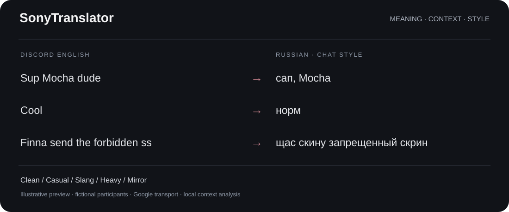

# SonyTranslator

Discord-Nachrichten übersetzen und Bedeutung sowie Schreibstil erhalten. Von **SonyDev**.

[English](../README.md) · [Русский](README.ru.md) · [Deutsch](README.de.md) · [简体中文](README.zh-CN.md)

## Installation von v0.9.4

1. **SonyTranslator-AutoInstaller-0.9.4.zip** unter [Releases](https://github.com/SonyDew/SonyTranslatorVencord/releases/latest) herunterladen.
2. Das gesamte Archiv entpacken.
3. **Install SonyTranslator.cmd** oder **Update SonyTranslator.cmd** starten.
4. Auf den Abschluss warten. Der zuvor gestartete Stable/Canary/PTB-Client wird wieder geöffnet.
5. Über die Übersetzer-Schaltfläche im Nachrichtenfeld Sprachen und Stil auswählen.

AutoInstaller benötigt Windows und baut Vencord lokal. Node 22+ und Git werden bei
Bedarf über winget installiert. Das Fenster zeigt die Schritte; Details stehen im Log.
Einstellungen und andere Plugins bleiben erhalten. Bei Fehlern wird SonyTranslator
wiederhergestellt. War zuvor kein Discord aktiv, wird kein beliebiger Client gestartet.

## Funktionen

- Eingehende und ausgehende Nachrichten über Google Translate, ohne bezahlten API-Schlüssel oder verpflichtendes LLM.
- Unabhängige Modi Clean, Casual, Slang, Heavy und Mirror.
- Erkennung von Chat-Slang, Abkürzungen, eindeutigen Tippfehlern, Reaktionen und Gaming-Ausdrücken.
- Schutz von Namen, Erwähnungen, URLs, Code, Dateien und Emoji.
- Übersetzte Antwortvorschauen in der Reihenfolge `@Name → Text`, mit nativer Schrift und Farbe.
- Englisch, Deutsch, Russisch, Ukrainisch, Chinesisch (Festland/Taiwan getrennt), Spanisch, Französisch, brasilianisches Portugiesisch, Polnisch, Japanisch und Koreanisch.

Clean bleibt natürlich und korrekt; Casual verwendet Alltagssprache; Slang und Heavy
komprimieren stärker; Mirror folgt dem Original. Neutrale Nachrichten erhalten keine
erfundenen Beleidigungen. `Cool` als Reaktion wird von einer Temperaturbeschreibung unterschieden.

## Datenschutz und Grenzen

Die Oberfläche folgt automatisch der Discord-Sprache, einschließlich Einstellungen,
Benachrichtigungen und Sprachnamen. Es gibt zwölf Sprachprofile; für andere Sprachen
wird Englisch verwendet. Lese- und Sendesprache bleiben unabhängig wählbar.

Nur die aktuelle Nachricht, bei Bedarf lokal normalisiert, geht an Google. Antwortkontext,
relevante vorherige Nachrichten und Teilnehmerdaten werden lokal ausgewertet. Neue Memes,
Ironie und mehrdeutige Abkürzungen können weiterhin falsch verstanden werden.

## Lizenz

Originalautor: **SonyDev / SonyDew**. Persönliche Nutzung und private Änderungen sind erlaubt.
Das Projekt darf nicht als eigene Arbeit ausgegeben werden. Veröffentlichung, Weiterverteilung
oder Umbenennung einer verbesserten Version erfordern vorherige schriftliche Zustimmung
von SonyDev und sichtbare Nennung des Originalautors. Anfragen über [Issues](https://github.com/SonyDew/SonyTranslatorVencord/issues).
Maßgeblich ist die englische [LICENSE](../LICENSE). Drittanbieter-Lizenzen und zuvor
gewährte MIT-Rechte bleiben gültig. Dies ist eine Source-available-Lizenz mit
Verteilungsbeschränkungen, keine freie Open-Source-Lizenz.
